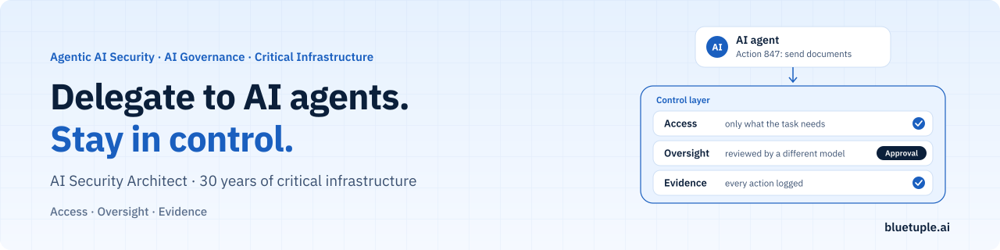

<picture>
  <source media="(prefers-color-scheme: dark)" srcset="banner-dark.svg">
  <source media="(prefers-color-scheme: light)" srcset="banner-light.svg">
  
</picture>

AI agents read email, file documents and act in business software, hundreds of times a day, with permissions someone granted them. Three questions decide whether that goes well: **What may the agent do? Who checks it, in a way that still works at the thousandth action? And what can you prove when auditors, regulators or insurers ask?**

I build the architecture that answers them: access, oversight and evidence for AI agents. Thirty years of critical infrastructure, from Zero Trust for 6,000+ branches to NIS2 engagements with utilities and insurers. Founder of [bluetuple.ai](https://www.bluetuple.ai).

### Access · what may the agent do?

- 🐳 **[claude_in_devcontainer](https://github.com/michaelhannecke/claude_in_devcontainer)**: run Claude Code in isolated multi-container dev environments, with the agent separated from host and secrets
- ☁️ **[foundry-tf](https://github.com/michaelhannecke/foundry-tf)**: Azure AI Foundry (hub and project) with Terraform, private by default

### Oversight · who checks it, at scale?

- 🛡️ **[claude-injection-guard](https://github.com/michaelhannecke/claude-injection-guard)**: two-stage prompt injection protection for Claude Code agents, rules first, then a *different*, local model as an independent reviewer

### Evidence · what can you prove?

- 🔑 **[appcredmon](https://github.com/michaelhannecke/appcredmon)**: monitor and alert on expiring app registration credentials in Azure / Entra ID
- 🧭 *In progress:* a reference control architecture for agents (independent reviewer, risk-based escalation, audit-grade logging) and a secure harness baseline for coding agents

### Local AI · keep sensitive data in the building

- ⚡ **[sovereign-vllm-metal](https://github.com/michaelhannecke/sovereign-vllm-metal)**: vLLM on Apple Silicon (Metal), from setup to security hardening
- 💻 **[claude-code-local](https://github.com/michaelhannecke/claude-code-local)**: Claude Code with local models on Apple Silicon via Ollama and LiteLLM
- 🔀 **[ccr-local](https://github.com/michaelhannecke/ccr-local)**: Claude Code Router for local LLMs, containerised

### Enterprise tooling

- 📊 **[pbi-mcp-wiki-generator](https://github.com/michaelhannecke/pbi-mcp-wiki-generator)**: generate documentation wikis from Power BI files via an MCP server

### Writing

- [Medium](https://medium.com/@michael.hannecke): hands-on patterns for agentic AI security and local AI
- [LinkedIn](https://www.linkedin.com/in/michaelhannecke/): AI security, governance and the EU AI Act for decision makers

---

📍 Krefeld, Germany · [bluetuple.ai](https://www.bluetuple.ai) · Open to project work as AI Security Architect
